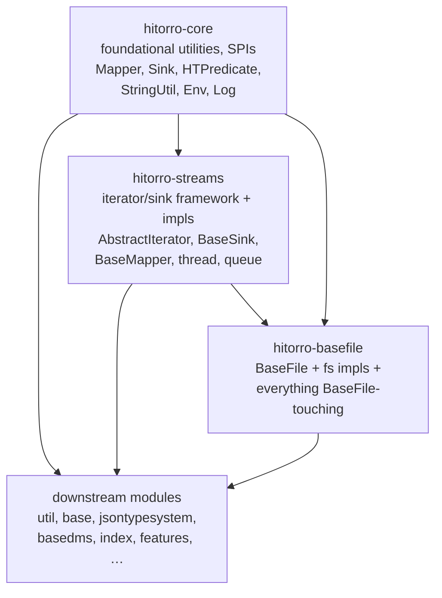
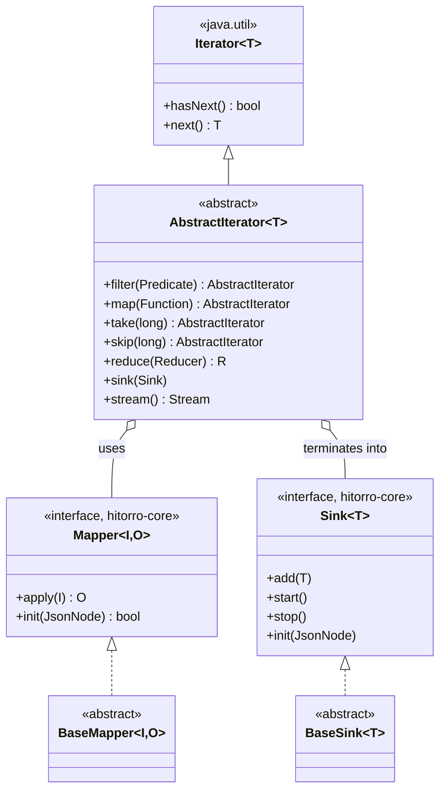

# hitorro-streams

Iterator / sink / mapper / reducer pipeline framework for the HiTorro family.

`hitorro-streams` is the SPI + concrete implementations of the streaming
abstractions the rest of HiTorro is built on:

- **Iterators** (`AbstractIterator<T>`) — chainable, `Iterator<T>`-compatible sources with
  filter/map/take/skip/reduce/sink methods, plus retry/rate-limit/parallel decorators
- **Mappers** (`Mapper<I, O> extends Function<I, O> + JsonInitable`) — configuration-aware
  transformations; `BaseMapper` for pooled/stateful variants
- **Sinks** (`Sink<T> extends Consumer<T> + AutoCloseable + JsonInitable`) — pluggable
  terminal endpoints with counting, filtering, maxPerTxn, async-via-ThreadedQueue variants
- **Reducers** — fold `AbstractIterator<T>` into a single value (`ListReducer`, `SumReducer`, …)
- **MapChains** — declarative pipelines that turn a chain of mappers into an `AbstractIterator`
- **Thread & queue** — `RestartableService`, `ThreadTimer`, `ThreadedQueue`, `JobFarm`
- **Large-data compressed streams** — `CInputStream` / `COutputStream` /
  `FSInputStream` / `FSOutputStream` / `RAMInputStream` (Lucene-derived) used everywhere
  block-formatted files are read or written

The `Mapper`, `Sink`, `SinkFactory`, and `SinkFactoryHolder` interfaces themselves live in
`hitorro-core` so downstream code can implement them without pulling in this module; the
concrete implementations, decorators, and default factories live here.

## Position in the HiTorro dependency graph



Streams depends **only** on `hitorro-core`. It has **zero references to
`BaseFile`** — anything that reads or writes a `BaseFile` lives in
`hitorro-basefile`, which depends on both `hitorro-core` and `hitorro-streams`.
This lets streams be a purely computational module.

## Package layout

```
com.hitorro.util.core.iterator/
├── AbstractIterator                    - the base class every custom iterator extends
├── AbstractIteratorFactory             - factory decoupling AbstractIterator from concrete impls
├── DefaultAbstractIteratorFactory      - default factory used when streams is on the classpath
├── mappers/                            - BaseMapper, MapToTuple, SettableMapper, PoolMapper, …
├── sinks/                              - BaseSink, PredicatedSink, MappingSink, ThreadedQueueSink, …
├── reducers/                           - BaseReducer, ListReducer, SumReducer, StringifyReducer
├── mapchains/                          - IteratorMapChain, MapperMapChain, SinkMapChain
├── queue/                              - queue-backed iterator glue (BlockingQueueIterator, …)
├── database/                           - ResultSet → AbstractIterator adapter
├── helpers/                            - shortcut helpers (FileMappers, StringMappers, …)
└── json/                               - JSON-array streaming iterators

com.hitorro.util.core.thread/
├── RestartableService, RestartableServiceDaemon
├── ThreadTimer, TimerCallback
└── farm/                               - JobFarm — bounded worker-pool over an iterator

com.hitorro.util.core.queue/            - ThreadedQueue and blocking-queue wrappers

com.hitorro.util.io.largedata.compressedstreams/
├── CInputStream, COutputStream         - variable-length compressed I/O primitives
├── FSInputStream, FSOutputStream       - RandomAccessFile-backed C-streams
├── RAMInputStream                       - in-memory C-stream
├── InputInputStream, OutputOutputStream - adapters to java.io.*
└── BitVector                            - bit-packed vector I/O

com.hitorro.util.core.classes/          - AbstractIteratorFactory-backed classpath scanners
com.hitorro.util.core.http/             - a small HTTP client with an iterable-response mode
com.hitorro.util.core.map/              - MapUtil (no CSV bits), FPHashLongMap-adjacent helpers
com.hitorro.util.core.string/           - StringTokenIterator (iterator-backed tokenizer)
com.hitorro.util.json/                  - key/property/mapper/iterator utilities that use the framework
```

## Iterator model at a glance



Typical pipeline:

```java
AbstractIterator<Row> source = /* concrete impl */;
long count = source
    .filter(r -> r.status() == OK)
    .map(new EnrichMapper())
    .sink(new WriteToKafkaSink("topic-x"));
```

## Building

```bash
# from the reactor root
mvn install -DskipTests -pl hitorro-streams -am

# just this module (assumes hitorro-core is already installed to ~/.m2)
cd hitorro-streams
mvn install -DskipTests
```

Java 21 is required (uses records, `Stream.gather`, virtual-thread-friendly APIs
in a few places).

## Dependencies

| Kind | Group / artifact | Why |
|------|------------------|-----|
| Internal | `com.hitorro:hitorro-core` | `Log`, `Env`, `StringUtil`, `HTAssert`, `Constants`, and the `Mapper`/`Sink`/`HTPredicate`/`JsonInitable` SPI interfaces |
| Runtime | `com.fasterxml.jackson.core:jackson-databind` | Config init via `JsonNode` on Mapper/Sink |
| Runtime | `net.sf.trove4j:core` | Primitive-map iterators exposed as `AbstractIterator` |
| Test    | `junit-jupiter`, `mockito-core`, `assertj-core` | via reactor |

## When to reach for what

- Need a source of `T` you can chain `.filter/.map` on → extend `AbstractIterator<T>`
- Need a reusable transformation with JSON config → implement `Mapper<I, O>` (interface lives in `hitorro-core`)
- Need a terminal writer with lifecycle → extend `BaseSink<T>`
- Need pipelined pooling / bounded parallelism → wrap with `ThreadedQueueSink` or `JobFarm`
- Need a block-format binary file → `FSOutputStream` / `FSInputStream` + a `CompressedStreamIO`
- Need any of the above to work with a `BaseFile` (S3, HDFS, FTP, jar) → look in
  [hitorro-basefile](https://github.com/geekychris/hitorro-basefile), which provides
  BaseFile-typed variants (`BaseFileBucketWriter`, `CompressedStreamIteratorSink`, …)

## History

`hitorro-streams` was extracted from `hitorro-util` when it became clear that the
iterator / sink / mapper framework was independently reusable and had grown too large
to remain a subpackage of util. The `pre-basefile-extraction-2026-08-12` tag marks
the point at which `hitorro-basefile` was also split out, inverting the dependency
so streams has no `BaseFile` references.

## License

MIT (see the parent `hitorro-all` repo).
